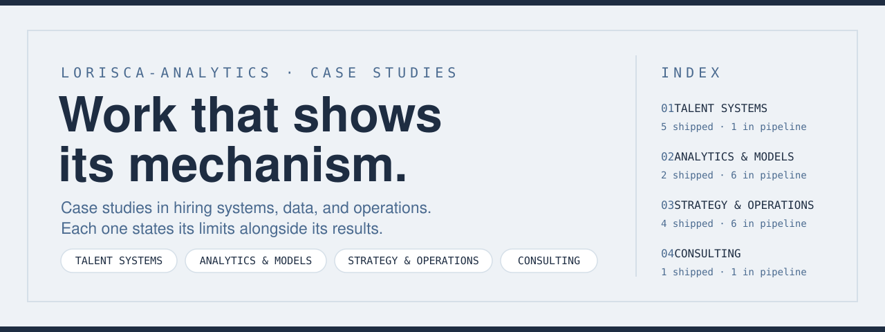

The through-line across everything here: the obvious metric points one way, the mechanism underneath points the other.

Case studies by <a href="https://github.com/lori-sca">Lorisca Tuuk</a>.

---

## Shipped

<!-- SHIPPED:START -->
<table>
<tr>
<td width="60%" valign="top">

`TALENT SYSTEMS`

### Which Employers Reliably Sponsor H-1B Business Roles

SQL analysis of 3.47M H-1B filings (2020–2023). The business-role wage premium survives on medians, then flips when IT managers are excluded.

**3.47M filings · 8 queries**

[Repo](https://github.com/lorisca-analytics/h1b-sponsorship-sql-analysis) · [All case studies](https://lorisca-analytics.github.io)

</td>
<td width="40%" valign="top">

</td>
</tr>
<tr>
<td width="60%" valign="top">

`TALENT SYSTEMS`

### The recruitment front door

Every screened candidate, from every portal, through one door. Then fixed rules decide eligibility on paper, and the interview decides selection.

**Hiring turnaround about -80%**

[Repo](https://github.com/lorisca-analytics/recruitment-front-door) · [All case studies](https://lorisca-analytics.github.io)

</td>
<td width="40%" valign="top">

</td>
</tr>
<tr>
<td width="60%" valign="top">

`TALENT SYSTEMS`

### Who leaves federal agencies first

OPM's raw files showed the Army reporting 9 departures in September 2026, against a usual month of about 1,860. OPM flags Department of War data for that month as affected by a processing change. I check coverage and split out seasonal jobs before ranking anything, then show which agencies lose permanent staff year after year.

**Army: 9 separations reported in Sep 2026, against a usual month of about 1,860**

[Repo](https://github.com/lorisca-analytics/federal-attrition-signals) · [Dashboard](https://lorisca-analytics.github.io/federal-attrition-signals/) · [All case studies](https://lorisca-analytics.github.io)

</td>
<td width="40%" valign="top">

</td>
</tr>
<tr>
<td width="60%" valign="top">

`TALENT SYSTEMS`

### HR analytics in R: why accidents rose at every site

An HR analytics case on employee data from a 1,470-person company. The quick read said fund an engagement program at the one site where disengagement jumped. I checked it first. Holding each site's disengagement at its 2016 level, the 2017 accident rate barely moves, and almost all the extra accidents were mild. So I'd check how incidents get reported before spending on engagement. The same check on recruiting data showed channels can't be ranked until hire source is tracked.

**HR analytics · 1,470 employees · R**

[Repo](https://github.com/lorisca-analytics/people-analytics-r) · [Certificate: HR Analytics in R (DataCamp)](https://www.datacamp.com/statement-of-accomplishment/course/0f0a451a6bb3359417b6edd76cd0318f2368d2e9) · [All case studies](https://lorisca-analytics.github.io)

</td>
<td width="40%" valign="top">

</td>
</tr>
<tr>
<td width="60%" valign="top">

`TALENT SYSTEMS`

### Attrition was a promotion problem

Field sales kept losing people after I fixed hiring. I joined intake, exit interview, performance and training records and traced the exits to team leaders promoted for their sales numbers alone. This repo rebuilds that view on synthetic data.

**I cut department turnover about 15% (2023) and 17% (2024)**

[Repo](https://github.com/lorisca-analytics/sales-attrition-evidence-layer) · [Dashboard](https://lorisca-analytics.github.io/sales-attrition-evidence-layer/) · [All case studies](https://lorisca-analytics.github.io)

</td>
<td width="40%" valign="top">

</td>
</tr>
<tr>
<td width="60%" valign="top">

`ANALYTICS & MODELS`

### Where Should We Spend the Next Ad Dollar?

A marketing analytics lead has an ad budget and a room full of managers who read the business through sales volume. This dashboard makes the case for spending it elsewhere, and lets the room test the recommendation live.

**9,994 order lines · 20% discount ceiling**

[Repo](https://github.com/lorisca-analytics/superstore-discount-ceiling) · [Tableau Public](https://public.tableau.com/app/profile/lorisca.cessia.tuuk/viz/A1_EXTRACT_v3/Story1) · [Interactive dashboard](https://lorisca-analytics.github.io/superstore-discount-ceiling/dashboard/) · [All case studies](https://lorisca-analytics.github.io)

</td>
<td width="40%" valign="top">

</td>
</tr>
<tr>
<td width="60%" valign="top">

`STRATEGY & OPERATIONS`

### Delivery Economics

A white-glove delivery operation losing $1,156 on 13 orders. I rebuilt the whole case from 171 raw order lines: the cost model, the 7-day operating schedule, and the operating system that runs the day.

**171 order lines · 7-day schedule**

[Repo](https://github.com/lorisca-analytics/delivery-economics-dashboard) · [Presentation](https://lorisca-analytics.github.io/delivery-economics-dashboard/) · [Dashboard](https://lorisca-analytics.github.io/delivery-economics-dashboard/dashboard.html) · [Operations design](https://lorisca-analytics.github.io/delivery-economics-dashboard/operations.html) · [All case studies](https://lorisca-analytics.github.io)

</td>
<td width="40%" valign="top">

</td>
</tr>
<tr>
<td width="60%" valign="top">

`STRATEGY & OPERATIONS`

### The Bounce-Back

A marketing performance audit that pulled a team out of a Q3 collapse and back to profitability by Q6.

**6 quarters · −$360K to +$703K**

[Repo](https://github.com/lorisca-analytics/bike-venture-turnaround) · [All case studies](https://lorisca-analytics.github.io)

</td>
<td width="40%" valign="top">

</td>
</tr>
<tr>
<td width="60%" valign="top">

`STRATEGY & OPERATIONS`

### AI everywhere, without automating the moat

The board wanted AI everywhere. The people most exposed to it were the ones who held the community together, so I designed who owns each warning and where AI may act.

**11 days from warning to reorder in the case. Hours once the signal has an owner (demo on made-up data).**

[Repo](https://github.com/lorisca-analytics/relay-ai-transformation) · [Live demo](https://lorisca-analytics.github.io/relay-ai-transformation/) · [All case studies](https://lorisca-analytics.github.io)

</td>
<td width="40%" valign="top">

</td>
</tr>
<tr>
<td width="60%" valign="top">

`CONSULTING`

### Gig Worker Referral Platform

The bank already banks these people. It just can't see their income.

**39-person survey · 8 interviews · 4-role prototype**

[Repo](https://github.com/lorisca-analytics/gig-worker-referral-platform) · [Live prototype](https://gig-worker-referral-platform.lovable.app) · [All case studies](https://lorisca-analytics.github.io)

</td>
<td width="40%" valign="top">

</td>
</tr>
</table>
<!-- SHIPPED:END -->

---

## Featured walkthrough

<table>
<tr>
<td width="60%" valign="top">

`ANALYTICS & MODELS` `PYTHON`

### Reading the Massachusetts labor market through H-1B filings

I'm on an F-1 visa. Finding the right role isn't the whole job search. I need an employer who'll go the full distance: OPT → STEM OPT → H-1B. So I read 137,866 Massachusetts H-1B filings (FY2020–2024) and asked: do the business roles I'd apply to get sponsored as often, and pay as well, as the data-and-analytics roles my visa plan leans on?

**The answer:** 13,672 vs 14,035 filings. $105,000 vs $104,000 median pay, statistically the same. 0% vs 100% STEM, so the H-1B clock is tighter on the business side.

**The correction:** an earlier version reported $115,000 for the business median: 2,583 IT managers had slipped into the business group through their occupation code. Re-ran without them: $105,000. The notebook shows exactly what changed.

**The walkthrough:**
1. **Load** the Massachusetts disclosure file: 137,866 rows.
2. **Filter** to certified H-1B filings: 123,497 rows.
3. **Normalize** every wage to annual and report medians (typo'd pay units make averages meaningless).
4. **Group** by government occupation codes, not keyword matching, and pull the IT managers back out.
5. **Compare** with one groupby, plus bootstrap confidence intervals on the medians.

[Repo](https://github.com/lorisca-analytics/massachusetts-h1b-analysis) · [10-min video walkthrough](https://www.youtube.com/watch?v=SEite--Lkh4) · [Notebook](https://github.com/lorisca-analytics/massachusetts-h1b-analysis/blob/main/notebooks/h1b_ma_analysis.ipynb)

</td>
<td width="40%" valign="top">

</td>
</tr>
</table>

---

## The lanes

<!-- LANES:START -->
<table>
<tr>
<td width="50%" valign="top">

`TALENT SYSTEMS`

Hiring, retention, and workforce data.

**5 shipped** · 1 in the pipeline

</td>
<td width="50%" valign="top">

`ANALYTICS & MODELS`

SQL, machine learning, and BI built to support one decision, with limits stated.

**2 shipped** · 6 in the pipeline

</td>
</tr>
<tr>
<td width="50%" valign="top">

`STRATEGY & OPERATIONS`

Business cases, pricing, and delivery: the numbers behind the story.

**3 shipped** · 7 in the pipeline

</td>
<td width="50%" valign="top">

`CONSULTING`

Live-client engagements with real stakeholders and real constraints. Team-based consulting work with deliverables, distinct from solo analyses.

**1 shipped** · 1 in the pipeline

</td>
</tr>
</table>
<!-- LANES:END -->

---

<b>In the pipeline</b>: works in progress, real titles, no filler

 

<!-- PIPELINE:START -->
**Talent Systems**
- Making a gender-gap contradiction visible

**Analytics & Models**
- Predicting income bracket, and knowing when to stop
- Where a vaccine supply strategy should point
- A board bonus that looked already lost
- A sales peak that was not growth
- Forecasting a seasonal business three ways
- Testing a straight-line forecast against reality

**Strategy & Operations**
- Two identical-looking tech giants with opposite economics
- Cost of capital for a company that barely borrows
- Whether a Chilean neobank is actually revolutionary
- A brand that outgrew its own positioning
- Auditing an AI transformation pitch as the person funding it
- Scoring a hardware launch before planning it
- Designing a scorecard for a firm that only measured revenue

**Consulting**
- A procurement play for a design software company
<!-- PIPELINE:END -->

---

## All repos

<!-- REPOS:START -->
- [bike-venture-turnaround](https://github.com/lorisca-analytics/bike-venture-turnaround) - **The Bounce-Back** - A marketing performance audit that pulled a team out of a Q3 collapse and back to profitability by Q6.
- [delivery-economics-dashboard](https://github.com/lorisca-analytics/delivery-economics-dashboard) - **Delivery Economics** - A white-glove delivery operation losing $1,156 on 13 orders.
- [federal-attrition-signals](https://github.com/lorisca-analytics/federal-attrition-signals) - **Who leaves federal agencies first** - OPM's raw files showed the Army reporting 9 departures in September 2026, against a usual month of about 1,860.
- [gig-worker-referral-platform](https://github.com/lorisca-analytics/gig-worker-referral-platform) - **Gig Worker Referral Platform** - The bank already banks these people. It just can't see their income.
- [h1b-sponsorship-sql-analysis](https://github.com/lorisca-analytics/h1b-sponsorship-sql-analysis) - **Which Employers Reliably Sponsor H-1B Business Roles** - SQL analysis of 3.47M H-1B filings (2020–2023). The business-role wage premium survives on medians, then flips when IT managers are excluded.
- [massachusetts-h1b-analysis](https://github.com/lorisca-analytics/massachusetts-h1b-analysis) - **Massachusetts H-1B Analysis** - Reading the Massachusetts labor market through five years of public H-1B filing data: which employers sponsor repeatedly, and do business roles pay as well as analytics roles?
- [people-analytics-r](https://github.com/lorisca-analytics/people-analytics-r) - **HR analytics in R: why accidents rose at every site** - An HR analytics case on employee data from a 1,470-person company.
- [recruitment-front-door](https://github.com/lorisca-analytics/recruitment-front-door) - **The recruitment front door** - Every screened candidate, from every portal, through one door.
- [relay-ai-transformation](https://github.com/lorisca-analytics/relay-ai-transformation) - **AI everywhere, without automating the moat** - The board wanted AI everywhere. The people most exposed to it were the ones who held the community together, so I designed who owns each warning and where AI may act.
- [sales-attrition-evidence-layer](https://github.com/lorisca-analytics/sales-attrition-evidence-layer) - **Attrition was a promotion problem** - Field sales kept losing people after I fixed hiring. I joined intake, exit interview, performance and training records and traced the exits to team leaders promoted for their sales numbers alone.
- [superstore-discount-ceiling](https://github.com/lorisca-analytics/superstore-discount-ceiling) - **Where Should We Spend the Next Ad Dollar?** - A marketing analytics lead has an ad budget and a room full of managers who read the business through sales volume.
<!-- REPOS:END -->

---

<a href="https://lori-sca.github.io">Personal site</a> ·
<a href="https://lorisca-analytics.github.io">Analytics Work</a> ·
<a href="https://lorisca-builds.github.io">Builds</a> ·
<a href="mailto:loriscatuuk@gmail.com">Email</a> ·
<a href="https://www.linkedin.com/in/lorisca">LinkedIn</a> ·
<a href="https://github.com/lorisca-analytics">GitHub</a>

